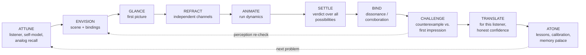

# Hyperphantasia: a mental-model reasoning path for AI

> When you memorise a process or reason something out, you often build a model that exists
> only in your mind. You can walk around it, run it, and feel when part of it doesn't fit.
> This document describes a reasoning path that gives an AI system the same ability, and the
> code in this repository runs a working version of it.

**Contents**

1. [The idea in one page](#1-the-idea-in-one-page)
2. [Why current models are "aphantasic"](#2-why-current-models-are-aphantasic)
3. [Six properties of a mental image, six components](#3-six-properties-of-a-mental-image-six-components)
4. [The reasoning path: the Phantasia Loop](#4-the-reasoning-path-the-phantasia-loop)
5. [The signal bus: what the model "feels"](#5-the-signal-bus-what-the-model-feels)
6. [Self-attunement (and atonement)](#6-self-attunement-and-atonement)
7. [Understanding and communicating](#7-understanding-and-communicating)
8. [Memorising: the memory palace](#8-memorising-the-memory-palace)
9. [What the prototype shows](#9-what-the-prototype-shows)
10. [From scaffold to native architecture](#10-from-scaffold-to-native-architecture)
11. [How to evaluate it](#11-how-to-evaluate-it)
12. [Limits and failure modes](#12-limits-and-failure-modes)
13. [References](#13-references)

---

## 1. The idea in one page

People who reason well with mental models do something specific. Kenneth Craik described it in
1943 as carrying "a small-scale model of external reality" in the head. Philip Johnson-Laird
showed experimentally that people reason by building models of the *possibilities* the premises
allow. Most reasoning errors come from building one model and stopping.

Imagery ability varies widely between people. At one end is **aphantasia** (no voluntary
imagery). At the other is **hyperphantasia**: imagery as vivid as perception, which can be held,
rotated and run. **Synesthesia** adds automatic cross-binding: one concept arrives in several
senses at once, and those senses agree with each other.

The proposal has one central claim:

> **A mental model helps reasoning because it is a different medium from the reasoning that built
> it.** The medium enforces its own constraints. You cannot imagine a room where the lamp is both
> left and right of the sofa; a timeline cannot hold an event both before and after another.
> Every constraint the medium enforces is one the reasoner no longer has to keep track of, and
> every disagreement between two media is a free error signal.

Larkin and Simon made the same point about diagrams in 1987. Diagrams make relations explicit by
location, cut down search, and let inferences be read off perceptually.

So the reasoning path is:

1. Build an explicit, persistent model of the problem with stable identities for every part.
2. Render it through several **independent channels** (picture, possibility space, proof graph,
   simulation, timeline, memory palace).
3. Treat their agreement as corroboration and their disagreement as **dissonance**.
4. Hunt for a counterexample to the first impression.
5. Turn internal signals into a calibrated confidence.
6. Explain the model to the specific listener as a guided tour of it.
7. Learn from your own surprises and errors (**self-attunement**). On error, localise the
   mistake to the stage that made it (**atonement**: owning an error means finding it and
   changing behaviour).



This can be added to an existing reasoning model as a scaffold: the language model handles
perception and voice, and a structured engine handles imagination. That version runs today and
is what this repository implements. It is also a path to a new architecture in which the
imagination is a persistent latent workspace inside the network ([section 10](#10-from-scaffold-to-native-architecture)).

---

## 2. Why current models are "aphantasic"

The claim needs to be stated carefully. Language models do form internal world representations;
probing work such as Othello-GPT found linearly decodable board states. What they lack is an
imagination that is **persistent, inspectable and manipulable as an object while they reason**.
Chain-of-thought serialises every intermediate state into a single stream of words. As a result:

| Mental imagery has…                                  | Token-stream reasoning instead…                                                  |
|------------------------------------------------------|----------------------------------------------------------------------------------|
| Parts that persist and keep their identity           | Re-derives the configuration from text every time it needs to "look" again      |
| A medium that enforces constraints                   | Lets contradictory statements sit on the page because nothing forces them into one frame |
| The ability to be run forward                        | Narrates dynamics instead of simulating them                                     |
| Many viewpoints on one object                        | Has one viewpoint: the sentence currently being written                          |
| Felt qualities (vivid/blurry, fits/doesn't fit)       | Has no native signal for "this part is underdetermined" or "this doesn't fit"   |
| Plural possibilities ("it could be this way or that") | Collapses to a single story; indeterminacy survives only if put into words      |

The last row matters most for correctness. The prototype's benchmark shows it directly: a
reasoner that reads answers off a single picture can never answer "undetermined", so on random
ordering puzzles it is right 34% of the time, against 100% for the full possibility space
([section 9](#9-what-the-prototype-shows)).

Related work has moved partway along this axis: drawing ASCII grids (Visualization-of-Thought),
sketching or plotting and then looking (Whiteboard-of-Thought, Visual Sketchpad), grounding in a
physics simulator (Mind's Eye), searching over thought trees (Tree of Thoughts), reasoning in
continuous latent space (Coconut), and planning with learned world models (World Models, Dreamer,
MuZero). What this proposal adds is the combination of **several independent renderings**,
**cross-modal dissonance as a control signal**, **explicit possibility spaces with counterexample
search**, and a **self-model that learns from the system's own surprises**.

---

## 3. Six properties of a mental image, six components

| Property of human imagery            | Component                                   | In this repo                                         |
|--------------------------------------|---------------------------------------------|------------------------------------------------------|
| 1. Parts persist with identity       | **Binding registry**: the Scene; every entity and premise gets a stable id (`p1`, `p2`…) | `hyperphantasia/scene.py`                           |
| 2. The medium enforces constraints   | **Channels with invariants**: weak/strict orders, populations, Venn regions, world state | `hyperphantasia/domains/*.py`                       |
| 3. It can be run                     | **Animate**: forward simulation of dynamics  | `ProcessDomain.run`, `ProcessDomain.repair`          |
| 4. It can be seen from several angles | **Refract**: one scene, several renderings, each with its own verdict | `Domain.refract` → `ChannelView`                     |
| 5. It carries felt qualities         | **Signal bus**: vividness, dissonance, surprise, corroboration, perception, novelty | `hyperphantasia/signals.py`                         |
| 6. Senses cross-bind (synesthesia)   | **Bind**: cross-channel consistency through the shared ids | `signals.bind`                                       |

Three components close the loop around them:

* **Memory palace**: a library of solved *shapes* of problems, used for analogy
  (`palace.py`).
* **Self-model and calibration ledger**: where my first impressions fail, how often I'm right at
  a given confidence, which stage was at fault last time (`attune.py`).
* **Listener model**: who is being spoken to and how they think (`attune.ListenerModel`,
  `translate.py`).

### Why channels must be independent

If every rendering is computed from one core, they agree trivially and catch nothing except bugs
in the core. Error detection needs **independent construction**, as in N-version programming.
The prototype pairs channels that reach the same answer by different methods:

| Domain       | Channel A (semantic)                        | Channel B (symbolic / diagrammatic)          | First impression            |
|--------------|---------------------------------------------|----------------------------------------------|-----------------------------|
| Spatial      | `possibilities`: enumerate every arrangement | `relations`: transitive closure, with a proof chain | `picture`: one preferred arrangement |
| Categorical  | `individuals`: enumerate every population   | `venn`: shade and mark regions               | `picture`: greedily built population |
| Process      | `simulation`: run the steps forward         | `causal links`: trace each need back to its supplier and find threats | face value: "it looks fine" |

A language model's direct answer can be added as a further independently built channel (`verbal`,
via `ClaudeBackend.intuit`). When it disagrees with the model, the loop does not overrule the
model. It **re-checks perception** instead, because a confident verbal reading that contradicts
an exact model usually means the scene was built wrong.

---

## 4. The reasoning path: the Phantasia Loop

Each stage writes to an inspectable trace (`Insight.report()`). Below, each stage gives its
purpose, then what the prototype does.

### 0. ATTUNE: who am I talking to, and what do I know about myself here?
Recall the listener model. Recall the self-model's first-impression reliability for this domain
and any lessons about problems of this shape. Recall the nearest analog from the memory palace.
*Prototype*: `SelfModel.glance_reliability`, `SelfModel.recall`, `MemoryPalace.recall`.

### 1. ENVISION: build the scene
Turn the problem into entities, premises and a question, each with provenance (the sentence it
came from). Anything that cannot be represented is recorded as a **hole** rather than guessed at,
and each hole lowers *perception confidence*. *Prototype*: `OfflineBackend` (restricted English)
or `ClaudeBackend` (open language → JSON-schema-constrained scene), both validated by
`schema.scene_from_dict`.

### 2. GLANCE: the first picture
Build the single preferred model the way a person would: in mention order, merging individuals
greedily. Read a tentative answer off it. This is System 1, and it is kept on purpose: it is
cheap, and its disagreement with the full model is the most useful lesson the system can store.

### 3. REFRACT: look at it through every sense
Render the scene through each channel. Each channel commits to a verdict by its own method or
abstains: the relational closure cannot represent "between", so it abstains on that premise
rather than guessing.

### 4. ANIMATE: run it
For anything with dynamics, simulate. In the process domain this rehearses the steps as written,
then searches for a working reordering that stays as close as possible to the stated one.

### 5. SETTLE: decide over the whole possibility space
`necessary` (true in every model), `impossible` (true in none), `possible` (some but not all,
with a **witness** and a **counterexample** exhibited), `inconsistent` (no model; the **minimal
conflicting premises** are computed), or for processes `works` / `fails` (with a repair).

Adaptive imagery: the loop starts with a *glimpse* budget and escalates to full imagination only
if the glimpse leaves the space unexplored. It skips deep imagery only where the self-model shows
trust has been earned: high first-impression reliability over at least 20 runs, the symbolic
channel agreeing, and no analog that previously misled.

### 6. BIND: do the senses agree?
Compute dissonance across independent channels, corroboration (how many independent channels
commit to the settled verdict) and abstentions.

### 7. CHALLENGE: try to break the first impression
If the glance said "yes", show the counterexample. If it said "no", show the witness. If it was
right, record that a counterexample search found none.

### 8. TRANSLATE: explain it to this listener
Present the model as a tour: the answer at the confidence actually earned, then the picture, the
proof chain, and the picture that breaks the obvious one. An honesty check rejects any rewrite
that claims more certainty than the calibrated confidence allows.

### 9. ATONE: learn
*Intrinsic*, after every problem, no grader needed: if the first impression misled, store a
lesson keyed by the problem's shape; if channels disagreed, log an internal fault; file the
problem's shape in the memory palace. *Extrinsic*, when told right or wrong: update the
calibration ledger and blame the most likely stage.

### A real trace (excerpt)

```
$ python -m hyperphantasia "The cup is left of the plate. The fork is left of the plate. Is the fork left of the cup?" --trace
[ATTUNE   ] listener=novice/picture; first-impression reliability in spatial = 0.50 over 0 run(s)
[ENVISION ] 3 entities, 2 premises, perception confidence 1.00
              [p1] left_of(cup, plate)  <- 'The cup is left of the plate.'
              [p2] left_of(fork, plate)  <- 'The fork is left of the plate.'
            query: left_of(fork, cup)
[GLANCE   ] first impression: impossible [imagery: glimpse]
            +-------+-------+-------+
            |  cup~ | fork~ | plate |
            +-------+-------+-------+
            ~ = blurry: position not fixed by the premises
[REFRACT  ] picture: impossible; possibilities: possible; relations: abstains
            <possibilities> (exhaustive model enumeration)
            x-axis: 3 arrangement(s)
               cup  <  fork  <  plate    [left -> right]
               fork  <  cup  <  plate    [left -> right]
               (cup = fork)  <  plate    [left -> right]
[BIND     ] dissonance 0.00, 1 independent channel(s) corroborate, 1 abstain
[CHALLENGE] counterexample found among 3 imagined model(s): the first impression does not hold
            +-------+-------+-------+
            | fork~ |  cup~ | plate |
            +-------+-------+-------+
[SETTLE   ] possible: Not determined. It is possible that fork is left of cup, but not necessary.
            signals: vividness=0.67 dissonance=0.00 surprise=yes corroboration=1 perception=1.00 novelty=1.00 confidence=0.95
[ATONE    ] lesson stored: first impression misled; schema filed in the memory palace
```

The `~` marks are vividness made visible. The cup and the fork are blurry because the premises do
not fix their positions, and that blur is exactly why the first picture cannot be trusted.

---

## 5. The signal bus: what the model "feels"

"Feel" is used functionally. Each signal is a number computed from the model and read the way a
person reads a gut feeling: as evidence about where to look next.

| Signal            | Definition in the prototype | What it steers |
|-------------------|-----------------------------|----------------|
| **Vividness** (per entity) | Fraction of the entity's relations to the others (on each axis, or across the four categorical forms) that are identical in every possible world. 1 = crisp, 0 = blur. | Where the first picture is untrustworthy; drawn as `~` |
| **Dissonance**    | Fraction of committed independent-channel pairs that disagree | Internal fault: lowers confidence, logs a lesson, blames "reasoning" |
| **Surprise**      | The first impression differs from the settled verdict | Lessons; lowers first-impression reliability; forces full imagery on similar problems later |
| **Corroboration** | Independent channels committing to the settled verdict | Confidence |
| **Perception**    | Validated parse confidence × (1 − 0.3 per unrepresented sentence) | Confidence; triggers perception re-check |
| **Novelty**       | 1 − similarity to the nearest stored shape | Whether an analog is offered |
| **Confidence**    | P(scene right) × P(reasoning right \| scene), then calibrated per domain from the ledger | Wording, honesty check |

The confidence decomposition matters. Over a complete possibility space the reasoning step is
exact, so nearly all residual risk sits in **perception**: whether the scene matches what was
meant. The architecture never assumes that factor away.

---

## 6. Self-attunement (and atonement)

"Self-attunement" here means the system reading its own state and adjusting to it. The
near-homophone "atonement" also fits: owning an error, finding where it came from, and changing
so it is less likely to recur. The architecture does both, concretely:

1. **Interoception.** The signals in [section 5](#5-the-signal-bus-what-the-model-feels) are
   first-class inputs to control, not after-the-fact logging.
2. **Calibration.** `CalibrationLedger` maps raw confidence to how often the system was actually
   right, per domain (histogram binning shrunk toward the raw score).
3. **A self-model.** `SelfModel` tracks first-impression reliability per domain, internal-fault
   events, and lessons keyed by problem shape. These are recalled at ATTUNE and change behaviour:
   a shape that once misled disables the shortcut.
4. **Error localisation (the atonement step).** On negative feedback, `PhantasiaLoop.feedback`
   assigns blame. If perception was imperfect, the fault is in ENVISION. If the space was not
   fully explored, it is the imagination budget. If channels disagreed, it is reasoning.
   Otherwise, because reasoning over a complete space is exact, the scene itself must have
   misrepresented the problem. Exact reasoning is valuable here partly because it localises
   errors.
5. **Metacognitive compute.** Deep imagery is spent where first impressions are unreliable and
   saved where reliability has been earned.
6. **The honesty invariant.** Certainty words ("definitely", "certainly", "guaranteed"…) are
   allowed only at calibrated confidence ≥ 0.97 and are checked mechanically
   (`honesty_violations`). An eloquent rewrite that overclaims is rejected.

The same mechanism extends to values. A channel whose invariants are commitments ("never state
more certainty than earned", "never contradict an instruction") checks plans and wording the way
the spatial channel checks arrangements.

---

## 7. Understanding and communicating

Understanding something means having a model of it that you can run and query. Communicating it
means building a matching model in someone else's head. The TRANSLATE stage therefore treats
explanation as a **guided tour of the model**, adapted by a listener model:

* **picture** listeners get the diagram first; **words** listeners get prose orderings and
  populations ("there is someone who is an artist and a beekeeper; …"); **steps** listeners get
  the walk-through.
* **novices** get the warning about the misleading first picture and the analogy; **experts** get
  the verdict, the confidence and the decisive counterexample.
* Indeterminate answers are explained with two pictures, one where the claim holds and one where
  it fails. A second picture is usually the most persuasive way to correct a confident wrong
  intuition.
* Proofs cite premise ids (`fork < cup < plate < knife (via p1, p2, p3)`), so the listener can
  audit them.

With `ClaudeBackend`, the language model rewrites the explanation into natural prose for that
listener. It may not add claims, and the honesty check guards its certainty.

---

## 8. Memorising: the memory palace

The method of loci works because spatial memory is strong and a route imposes order. In the
process domain, the `palace` channel puts each step of the (repaired) procedure at a locus on a
route, with what it needs, what it leaves behind and what it takes away. It also attaches the
**reason for the ordering** to the place: "you can only reach this room after: Loosen the nuts,
Jack up the car". Memorising the route then means memorising the dependency structure, not just a
list.

The `timeline` channel gives the complementary view: dependency layers, which steps could run in
parallel, and the critical path.

At a higher level, `MemoryPalace` stores the *shape* of every solved problem: relation kinds,
size, question type, and whether the first impression misled. A new problem with the same shape
recalls the old one ("this has the same shape as an earlier problem where the first picture was
also misleading"). That is structure-mapping analogy in its simplest operational form, and it is
how a lesson learned once transfers.

---

## 9. What the prototype shows

`python examples/bench.py` (about one second, no network):

```
Syllogisms (256 forms)
  first impression correct: 152/256 (59%); it accepts 104 invalid form(s)
  full imagination:         256/256 (100%), 0 invalid forms accepted

Ordering puzzles (400, independent brute-force oracle)
  first impression correct: 134/400 (34%)
  full imagination correct: 400/400 (100%)

Noisy perception: half the scenes have one premise read backwards (feedback after each)
                      accuracy  raw conf  calibrated  Brier raw  Brier calibrated
  first 100             79.0%     97.4%       83.0%     0.2036            0.1726
  last 400              80.5%     97.1%       78.9%     0.1889            0.1576
```

The test suite (`pytest`, 26 tests) checks more:

* Across all 256 syllogistic forms, the engine finds **exactly the 24 classically valid
  syllogisms with existential import, and exactly 15 without**, including Barbara, Celarent,
  Darii, Ferio, Baroco and Bocardo. On every form, the Venn channel and the population channel
  agree (dissonance 0).
* On 150 random ordering problems, verdicts match an independent permutation oracle, and the
  closure and enumeration channels never disagree. The same holds on 120 random 2-D weak-order
  problems.
* For a contradictory scene, the minimal conflict set is exactly the premises in the cycle; the
  unrelated premise is not blamed.
* On 60 random shufflings of a procedure, simulation and causal-link analysis agree, and every
  proposed repair works.
* A rewrite that overclaims certainty is rejected; listener preferences change the explanation
  but not the verdict; lessons persist across sessions and trigger analog recall.

What this does and does not show: the domains are small, and imagination is exact inside them by
construction. The results show that the **architecture behaves as designed**. Signals arise where
they should, single-picture reasoning fails in exactly the ways the theory predicts (it cannot
represent indeterminacy; it accepts illusory inferences), and self-attunement measurably repairs
overconfidence caused by perception errors the system cannot see. The open problem, which
the next section addresses, is breadth.

---

## 10. From scaffold to native architecture

### Stage A: Scaffold (this repository, works today)
The language model does perception (ENVISION), a fast verbal impression (an extra channel), the
perception re-check, and voice (TRANSLATE). Structured engines do imagination. Every call is
schema-constrained and validated (`backends/claude.py`, `schema.py`).

### Stage B: General imagination engines
Add channels with strong media:

* **Constraint solvers as possibility engines.** An SMT/SAT solver (e.g. Z3) is a general
  imagination: model finding is imagining a world, a second model with the query negated is a
  counterexample, and an **unsat core is localised dissonance**. A generic scene schema
  (entities, typed relations, constraints) plus a solver covers scheduling, logic grids,
  configuration and many planning problems.
* **Simulators**: physics (as in Mind's Eye), code execution (program state as imagery), causal
  graphs with interventions, unit-checked quantities.
* **Rendered images**: draw the scene and have a vision model look at it, as an independent
  channel (Whiteboard-of-Thought, Visual Sketchpad).
* **Imagination as program synthesis**: let the model write a small domain model as sandboxed code
  when no channel fits, then run it (PAL-style).

### Stage C: Make the loop native through training
Use Stage A/B traces to train the model to run the loop itself: emit the scene, the channel
renderings, the counterexample search and the calibrated verdict. Then apply RL with verifiable
rewards whose terms mirror the signal bus: correctness, Brier score on stated confidence,
counterexample-search success on indeterminate problems, cross-channel consistency, and the
honesty invariant. The signals give dense, process-level reward without human labels.

### Stage D: Native latent imagination ("Phantasm Slots")
A new architectural component for a decoder-only transformer. **This is a specification; it has
not been trained or run here.**

* **Imagination buffer** `M ∈ ℝ^{P×K×d}`: P parallel *possible worlds*, each with K slots,
  persistent across decoding steps and separate from the KV cache.
* **Write** (every N tokens or at an `<imagine>` token): slot attention over recent hidden states
  (competition gives objecthood and binding), then a GRU update per slot.
* **Read**: gated cross-attention from middle layers into the slots, with the gate initialised to
  0 so training starts from the unmodified base model (Flamingo-style).
* **Senses (channel decoders)**: spatial head (slot → coordinates or heatmap), relational head
  (slot pair → relation logits), temporal head (slot pair → P(before)), quantitative head
  (value + unit), and the ordinary LM head.
* **Dynamics**: a small transformer `f(M, op) → M'`, trained JEPA-style to predict the encoded
  next state (latent imagination rollout, as in Dreamer).
* **Differentiable dissonance**: relations implied by the spatial head (e.g.
  `σ((x_j − x_i)/τ)` for "i left of j") compared with the relational head; temporal head
  compared with dynamics. It is both a training loss and an inference-time signal.
* **Interoception**: the signals (dissonance, per-slot vividness, disagreement across the P
  worlds) are embedded and added to the next input token. The model *feels* its imagination.
* **Plural worlds = native counterexample search**: each world must satisfy the premises
  (constraint loss), while a diversity loss pushes worlds apart on relations the premises leave
  free. A query that holds in all P worlds is necessary; one that splits them is possible.
* **Halting**: an adaptive-computation controller keeps imagining while dissonance is high or
  vividness is low on query-relevant slots.

```python
class PhantasmSlots(nn.Module):                      # specification sketch, PyTorch-style
    def __init__(self, d_model, P=4, K=64, d=512, n_rel=16, tau=0.1):
        self.M0 = nn.Parameter(torch.randn(P, K, d) * .02)
        self.write = SlotAttention(d_in=d_model, d_slot=d, iters=3)
        self.gru = nn.GRUCell(d, d)
        self.read = nn.MultiheadAttention(d_model, 8, kdim=d, vdim=d, batch_first=True)
        self.gate = nn.Parameter(torch.zeros(1))     # tanh(0) = 0: starts as the base model
        self.vivid = nn.Linear(d, 1)
        self.spatial, self.rel = nn.Linear(d, 2), Bilinear(d, n_rel)
        self.signal_embed = nn.Linear(3, d_model)    # interoception
        self.tau = tau

    def imagine(self, M, H):                         # H: recent hidden states [B, T, d_model]
        upd = self.write(H, M)                       # [B, P, K, d]
        return self.gru(upd.flatten(0, 2), M.flatten(0, 2)).view_as(M)

    def perceive(self, h, M):                        # inside a middle layer
        mem = M.flatten(1, 2)                        # all worlds' slots
        r, _ = self.read(h, mem, mem)
        return h + torch.tanh(self.gate) * r

    def feel(self, M):
        xy = self.spatial(M)                                         # [B, P, K, 2]
        implied = torch.sigmoid((xy[..., None, :, 0] - xy[..., :, None, 0]) / self.tau)
        graph = torch.sigmoid(self.rel(M, M)[..., LEFT_OF])
        dissonance = F.binary_cross_entropy(graph, implied.detach())  # picture vs. graph
        vivid = torch.sigmoid(self.vivid(M)).squeeze(-1)             # [B, P, K]
        spread = graph.var(dim=1).mean()                             # worlds disagree => open
        return dissonance, vivid, spread

# L = L_lm + λ1·Σ L_render(head, ground truth)   # synthetic worlds supply ground truth
#       + λ2·L_dissonance + λ3·‖f(M_t, op) − sg(M_{t+1})‖²
#       + λ4·L_premise(each world) − λ5·L_diversity(free relations)
#       + λ6·Brier(confidence, correct)          # then RL with verifiable rewards
```

**Training curriculum.** (1) Freeze the LM and train slots and heads on procedurally generated
worlds (grids, block towers, ordering puzzles, physics, process graphs, code traces), which
provide ground truth for every channel. (2) Unfreeze adapters and train jointly on synthetic plus
natural reasoning data, where natural data gets only LM, consistency and dynamics losses.
(3) Run RL on verifiable tasks with the Stage C rewards, warm-started from scaffold traces.

**How to tell the imagination is actually used.** Probe the slots for linearly decodable world
state, then **intervene**: edit a slot (move the "fork" left) and check that the answer changes
accordingly. If editing the imagination does not change the reasoning, the model is not
reasoning with it. [IMAGINATION_DETECTOR.md](IMAGINATION_DETECTOR.md) builds this test, calibrates
it on subjects with known internals, and applies it to a plain transformer and to a small
Phantasm Slots network.

**Why it matters for alignment.** At any moment the slots can be decoded into pictures, graphs
and timelines. "Show me what you're imagining" becomes a real interpretability interface, and
self-attunement becomes literal: the model can read its own imagination.

---

## 11. How to evaluate it

| Capability | Benchmarks | Metric beyond accuracy |
|---|---|---|
| Spatial reasoning | StepGame, SpartQA, bAbI (positional / path finding) | robustness to paraphrase |
| Deduction | PrOntoQA, FOLIO, classical syllogisms | **indeterminacy recall**: does it say "doesn't follow" when it doesn't? |
| Planning / procedures | PlanBench (Blocksworld), procedure repair | repair minimality, missing-step detection |
| Physical / causal | CLEVRER, simulated physics QA | counterfactual accuracy |
| Abstraction | ARC | analog retrieval helpfulness |
| Calibration | all of the above | ECE, Brier; overclaim rate under the honesty check |
| Self-attunement | streams with feedback | Brier improvement over time; blame-assignment accuracy on injected faults |
| Communication | human ratings | listener comprehension (can they answer follow-ups after reading the explanation?) |

**Ablations**: single channel only; channels derived from one core (no independence); no
CHALLENGE; no self-model; no listener model; glimpse-only versus adaptive imagery (compute against
accuracy). **Baselines**: plain chain-of-thought (the "aphantasic" reasoner), self-consistency,
Tree of Thoughts, Visualization-of-Thought.

---

## 12. Limits and failure modes

* **Perception is the bottleneck.** Turning language into a faithful scene is where most real
  errors occur; neuro-symbolic systems have repeatedly found the same thing. The architecture
  reports this risk honestly (the perception signal, the re-check, blame assignment) but does not
  remove it. The offline parser is deliberately narrow.
* **Combinatorial growth.** Exhaustive enumeration does not scale. Budgets, partial-search
  semantics (a cut-short search can still prove "possible" by exhibiting both cases, but never
  "necessary"), solvers and sampling are needed.
* **Vivid but wrong.** Hyperphantasia's characteristic failure is confabulation: a detailed,
  self-consistent image of something false. A coherent wrong model *feels* certain. The
  mitigations are designed in: vividness is earned by determinacy rather than detail, channels are
  built independently, a disagreeing verbal reading triggers a perception check, and calibration
  learns from outcomes.
* **Not everything is picturable.** Ethics, open-ended writing and taste do not reduce to
  possibility spaces. Low novelty, abstaining channels and the adaptive-imagery dial should let
  the system notice when imagery does not apply and fall back to ordinary reasoning.
* **Anthropomorphism.** "Feel", "vivid" and "atone" are functional analogies, defined by the
  computations in [section 5](#5-the-signal-bus-what-the-model-feels). They make no claim about
  experience.

---

## 13. References

* Ainsworth, S. (2006). DeFT: A conceptual framework for considering learning with multiple representations. *Learning and Instruction*, 16(3).
* Alayrac, J.-B., et al. (2022). Flamingo: a visual language model for few-shot learning. *NeurIPS*.
* Battaglia, P., Hamrick, J., & Tenenbaum, J. (2013). Simulation as an engine of physical scene understanding. *PNAS*, 110(45).
* Craik, K. (1943). *The Nature of Explanation*. Cambridge University Press.
* de Moura, L., & Bjørner, N. (2008). Z3: An efficient SMT solver. *TACAS*.
* Gentner, D. (1983). Structure-mapping: A theoretical framework for analogy. *Cognitive Science*, 7(2).
* Graves, A. (2016). Adaptive computation time for recurrent neural networks. arXiv:1603.08983.
* Ha, D., & Schmidhuber, J. (2018). World models. arXiv:1803.10122.
* Hafner, D., et al. (2023). Mastering diverse domains through world models (DreamerV3). arXiv:2301.04104.
* Hao, S., et al. (2024). Training large language models to reason in a continuous latent space (Coconut). arXiv:2412.06769.
* Hu, Y., et al. (2024). Visual Sketchpad: Sketching as a visual chain of thought for multimodal language models. arXiv:2406.09403.
* Johnson-Laird, P. N. (1983). *Mental Models*. Harvard University Press; (2006) *How We Reason*. Oxford University Press.
* Kadavath, S., et al. (2022). Language models (mostly) know what they know. arXiv:2207.05221.
* Lake, B., Ullman, T., Tenenbaum, J., & Gershman, S. (2017). Building machines that learn and think like people. *Behavioral and Brain Sciences*, 40.
* Larkin, J., & Simon, H. (1987). Why a diagram is (sometimes) worth ten thousand words. *Cognitive Science*, 11(1).
* LeCun, Y. (2022). A path towards autonomous machine intelligence. OpenReview.
* Li, K., et al. (2023). Emergent world representations: Exploring a sequence model trained on a synthetic task. *ICLR*.
* Liu, R., et al. (2023). Mind's Eye: Grounded language model reasoning through simulation. *ICLR*.
* Locatello, F., et al. (2020). Object-centric learning with slot attention. *NeurIPS*.
* Menon, S., Zemel, R., & Vondrick, C. (2024). Whiteboard-of-Thought: Thinking step-by-step across modalities. arXiv:2406.14562.
* Ramachandran, V. S., & Hubbard, E. M. (2001). Synaesthesia: A window into perception, thought and language. *Journal of Consciousness Studies*, 8(12).
* Schrittwieser, J., et al. (2020). Mastering Atari, Go, chess and shogi by planning with a learned model. *Nature*, 588.
* Wang, X., et al. (2023). Self-consistency improves chain of thought reasoning in language models. *ICLR*.
* Weld, D. (1994). An introduction to least commitment planning. *AI Magazine*, 15(4).
* Wu, W., et al. (2024). Mind's Eye of LLMs: Visualization-of-Thought elicits spatial reasoning in large language models. *NeurIPS*.
* Yao, S., et al. (2023). Tree of Thoughts: Deliberate problem solving with large language models. *NeurIPS*.
* Yates, F. (1966). *The Art of Memory*. Routledge & Kegan Paul.
* Zeman, A., Dewar, M., & Della Sala, S. (2015). Lives without imagery: Congenital aphantasia. *Cortex*, 73.
* Zeman, A., et al. (2020). Phantasia: The psychological significance of lifelong visual imagery vividness extremes. *Cortex*, 130.
